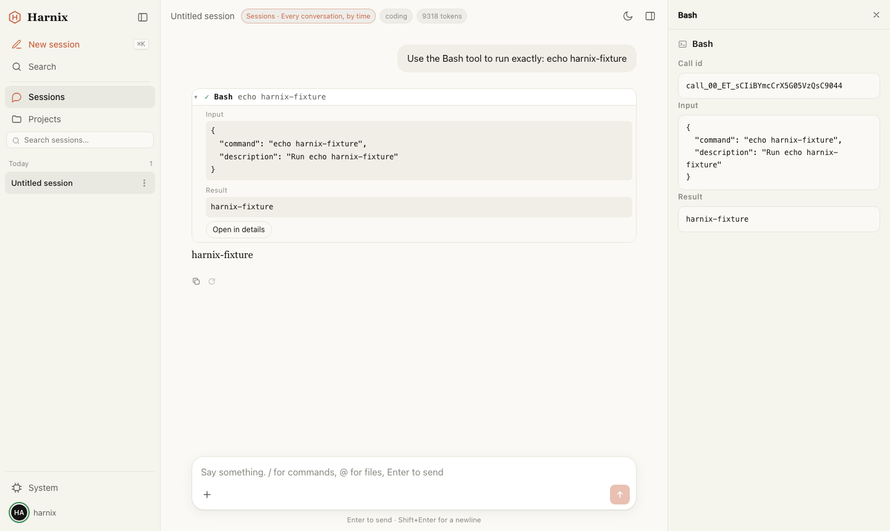

# Harnix

English | [简体中文](README.zh-CN.md)

**The common base for [Agix](https://github.com/openatta/agix) applications.** An application on
Harnix is one Rust binary: the Agent engine, the web server, the application's own modules and its
interface, compiled together. Harnix supplies everything such a product needs and cannot sensibly
build alone — holding sessions so that nothing depends on a browser tab, instances, authorization,
transport, the shell, spaces, a system view — and stays thin, so the product is the application's.



## Status

0.4. Two products are being moved onto it (Helm and IPDrun; see their migration guides below). The
module API and the protocol only grow within 0.4.z; pin a tag (`Harnix-v<x.y.z>-<date><n>`) if you
depend on one.

## Run it

```sh
git clone --recurse-submodules https://github.com/openatta/Harnix.git
cd Harnix
pnpm install && pnpm --filter @harnix/shell build   # the interface; the binary embeds it
cargo build --release
./target/release/harnix                              # → http://127.0.0.1:4080/
```

Rust 1.87 or newer, Node with pnpm for the interface. `--recurse-submodules` matters: Agix lives at
`agix/`. What runs is the empty application: Harnix's three built-in spaces and nothing else.

No environment variable is required. With no model configured it still starts, and the page says
so: **Set up a model** (or the avatar → **Settings → Models & credentials**) adds providers — as many
as you like, each an Anthropic or OpenAI-compatible API, one of them the default. They go to the
global `~/.agix/settings.json`, take effect without a restart, and never reach the browser or the
logs. `ANTHROPIC_AUTH_TOKEN` (plus an optional `ANTHROPIC_BASE_URL`) works too.

## What an application gets

- **A turn belongs to the server, not to a tab.** The hub subscribes to every session before any
  client asks, so a reload, another device or a dropped connection catches up from buffered frames
  by `seq`. Clients and the application's own modules drive sessions through one set of semantics:
  queueing, interrupting, steering, headless sessions with a tap.
- **Modules, compiled in.** A `harnix::Module` declares its methods (`app.<id>.*`), topics, routes,
  native tools and scenes, instance templates and spaces; it gets a context, not the hub's internals.
  A module that fails to migrate or start is disabled alone, with the reason on the diagnostics page.
- **Instances.** Several Agix engines behind one link — in-process, or daemons spawned and supervised
  or attached — built from templates, isolated from each other, kept in a ledger across restarts.
- **Spaces.** A space is the three columns together: its own left column, a centre that is the
  conversation unless it says otherwise, and its own right tabs. Harnix's three — sessions by time,
  projects as a tree, and the system space — are examples a product keeps or drops.
- **A system space for debugging.** A console of what is running right now — instances, their running
  sessions, their running tasks — and, for anything picked, every model call with exactly what went
  in and what came out, the context the next call will carry, the tasks, the frames as they arrive.
- **Cards in the conversation.** A module writes extension entries into a session's log: they survive
  a refresh, a replay and a fork, and the model never sees them. Approval cards are built this way.
- **Its own look without a fork.** `[brand]` names the product and its icon; modules override theme
  tokens and bring language packs. The program's own state lives in `~/.<product_id>`.
- **Installed packages can draw.** An Agix package's interface module is a precompiled ES module that
  takes React from the page's import map — admitted by its hash in an otherwise strict CSP, and
  switchable off per product.
- **A desktop shell.** `templates/desktop` wraps an application in Tauri 2, locally or against a
  remote Harnix, with no IPC: all business traffic is the page's own HTTP/WS.
- **Tests against the real binary.** `@harnix/testkit` starts the application, replays model calls
  from recordings, and drives the API and the interface (Playwright).

## Build an application

Copy `templates/app`, add `agix/` and `harnix/` as sibling submodules, and follow the
[SDK guide](docs/harnix-sdk.md); every interface is listed in the [SDK reference](docs/harnix-sdk-reference.md).
`examples/hello-app` is a complete application with two spaces, its own instance, a long job with a
result card, its own HTTP route and WebSocket, an approval card and a brand.

```rust
fn main() -> anyhow::Result<()> {
    harnix::App::builder()
        .name("hello-app", env!("CARGO_PKG_VERSION"))
        .with_builtins()
        .module(Greeter::default())
        .run()
}
```

## Profile and options

A profile says what the process is; flags override it.

```toml
[brand]
name = "Hello"
icon = "brand.svg"
product_id = "hello-app"         # state in ~/.hello-app

[shell]
spaces = ["sessions", "projects"]   # the built-in spaces to keep (all three when absent)

[ui]
runtime_modules = true           # installed packages' interface modules

[modules.greeter]                # each module's own section
```

| Option | Meaning |
|---|---|
| `--profile` | The profile above; every section refuses keys it does not know |
| `--port` / `--host` | Defaults `4080` / `127.0.0.1`; a non-loopback bind needs TLS and paired devices |
| `--agix-dir` | The engine's directory, default `$AGIX_CONFIG_HOME`, then `~/.agix` (shared with `agixd`) |
| `--data-dir` | Where projects are, default `$HARNIX_DATA_DIR`, then `~/Documents` |
| `--ui-dir` / `--headless` | Serve the interface from a directory / serve none |
| `--launch-link` | Keep the token out of the page: browsers come in through one-time links |

## Directories

| Path | What |
|---|---|
| `~/.agix/` | The engine: settings tiers, transcripts, memory, skills, recordings |
| `~/.<product_id>/` | The program's own configuration and state: token, devices, workspaces, ledgers, instances' data, each module's data (`~/.harnix` by default; `HARNIX_STATE_DIR` moves it) |
| `~/Documents/` | Projects only — nothing hidden in it |
| `<project>/.agix/` | A project's own data and settings |

## Layout

```
crates/harnix     the crate an application depends on, and the `harnix` binary (the empty application)
crates/app        App::builder(): profile, start order, module lifecycle, diagnostics
crates/module     the compile-time module contract: Module, its registries, ModuleContext
crates/hub        the session hub: instances, subscription, replay, seq, turn ownership, queue, topics
crates/instance   Agix instances: in-process or a daemon (spawned or attached), behind one link
crates/transport  channel semantics over a chosen topology: frames, handshake, static face, bulk, /apps/<id>/
crates/authz      the one admission point: subject × method/route/topic, default deny, audited
crates/builtin    Harnix's own features, as modules written against the public contract
crates/contract   the types those layers hand each other
crates/testapp    an application for the tests: modules that work and modules that fail on purpose

ui/packages/      @harnix/core (protocol, client, session state), @harnix/react (conversation,
                  contribution registry, i18n, tokens), @harnix/shell (the interface), @harnix/testkit
templates/app     a new application
templates/desktop the desktop shell (Tauri 2)
examples/hello-app  an application built the way applications are
tests/live/       the LIVE suites: Playwright Test against the real binary
agix/             Agix (submodule)
```

## Documentation

| Document | For |
|---|---|
| [docs/harnix-sdk.md](docs/harnix-sdk.md) | Building an application: the guide |
| [docs/harnix-sdk-reference.md](docs/harnix-sdk-reference.md) | Every type, method, profile key, flag, directory and contribution point |
| [docs/migration-helm.md](docs/migration-helm.md), [docs/migration-ipdrun.md](docs/migration-ipdrun.md) | Moving Helm and IPDrun onto 0.4 |
| [docs/concept_and_architecture.md](docs/concept_and_architecture.md) | What Harnix is and why it has this shape |
| [docs/contribution_points.md](docs/contribution_points.md) | The interface's contribution points, generated from the code |
| [docs/testing.md](docs/testing.md) | The test layers, the LIVE suites, recordings, the coverage table |
| [docs/glossary.md](docs/glossary.md) | The words, used one way |

*The documents are written in Chinese.*

## Tests

Every layer, cheapest first, with anything that could not run said out loud rather than dropped:

```sh
scripts/check.sh                # everything this machine can run
scripts/check.sh --fast         # skip the model and the browser
scripts/check.sh --only api     # one layer
scripts/check.sh --with-remote  # also pairing over TLS — opens a listener on this network
scripts/prune.sh                # build caches: drop incremental state, clean any target over 25 GB
```

The LIVE suites (`tests/live`, [docs/testing.md](docs/testing.md)) run the real binary: `api` drives
the backend through its own protocol, `ui` drives the interface in chromium, and model calls replay
from recordings unless `--live`.

**Do not run `cargo test --workspace`**: it would also run the absorbed Agix crates, two of which
assume they are their own workspace root. Run Agix's tests in Agix.

## License

[Apache-2.0](LICENSE).
