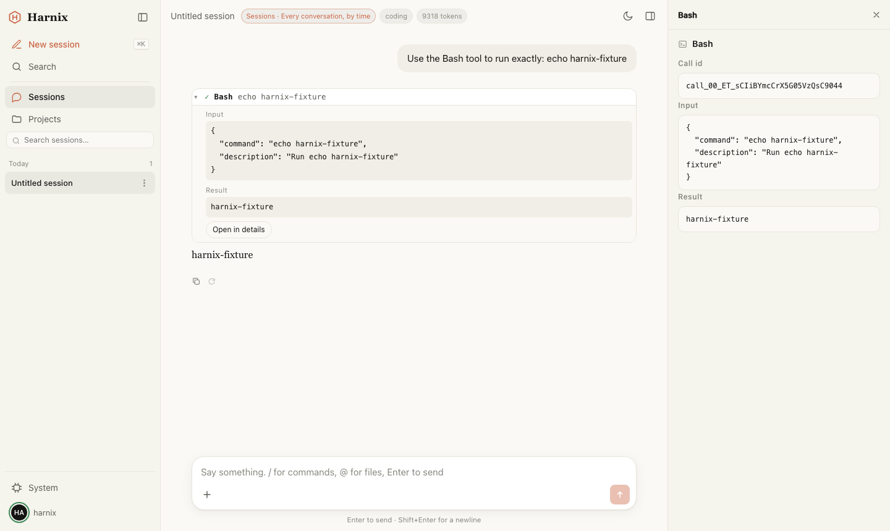

# Harnix

English | [简体中文](docs/README.zh-CN.md)

**The common base for [Agix](https://github.com/openatta/agix) applications.** An application on
Harnix is one Rust binary: the Agent engine, the web server, the application's own modules and its
interface, compiled together. Harnix supplies what such a product needs and cannot sensibly build
alone — sessions held by the server, engine instances, authorization, transport, the shell and its
spaces, a system view, an optional flow engine — and stays thin, so the product is the application's.



0.4. The module API and the protocol only grow within 0.4.z; pin a tag (`Harnix-v<x.y.z>-<date><n>`)
if you depend on one.

## Quick start

```sh
git clone --recurse-submodules https://github.com/openatta/Harnix.git
cd Harnix
pnpm install && pnpm --filter @harnix/shell build   # the interface; the binary embeds it
cargo build --release
./target/release/harnix                              # → http://127.0.0.1:4080/
```

Rust 1.87 or newer, Node with pnpm. `--recurse-submodules` matters: Agix lives at `agix/`. What runs
is the empty application: Harnix's built-in spaces — sessions, projects, flows, the system.

No environment variable is required. With no model configured it still starts and says so:
**Set up a model** (or the avatar → **Settings → Models & credentials**) adds providers — Anthropic or
OpenAI-compatible APIs, one of them the default — kept in `~/.agix/settings.json`, never shown to the
browser or the logs. `ANTHROPIC_AUTH_TOKEN` (plus an optional `ANTHROPIC_BASE_URL`) works too.

To look around with data in it: `scripts/harnix-demo.sh start` (also `stop`, `restart`, `status`)
runs the empty application in a directory of its own (`~/harnix-demo`) with demo flows, runs and
conversations; delete the directory to start over.

## Architecture

```
            browser / desktop shell (Tauri)            other clients, other modules
                        │  one protocol: frames, seq, topics, methods
 ┌──────────────────────▼──────────────────────────────────────────────────┐
 │ transport   one channel semantics over two topologies; static face; /apps/<id>/
 │ authz       the one admission point: subject × method / route / topic, default deny
 │ hub         sessions held by the server: subscription, buffered replay by seq,
 │             turn ownership, queue, steer, interrupt, headless taps, topics
 │ modules     compiled in: methods app.<id>.*, topics, routes, native tools and scenes,
 │             instance templates, spaces — builtin ones written against the same contract
 │ instances   Agix engines behind one link: in process, spawned daemons, attached;
 │             from templates, isolated, kept in a ledger across restarts
 └──────────────────────┬──────────────────────────────────────────────────┘
                        ▼
                  Agix (agix/): the engine — turns, tools, scenes, permissions, packages
```

- **A turn belongs to the server, not to a tab.** The hub subscribes to every session before any
  client asks; a reload, another device or a dropped connection catches up by `seq`. Clients and the
  application's own modules drive sessions through one set of semantics.
- **Modules are compiled in, not plugged in.** A `harnix::Module` declares what it contributes and
  gets a context, not the hub's internals. One that fails to migrate or start is disabled alone, with
  the reason on the diagnostics page. Plugins belong to Agix; Harnix runs nothing from a package.
- **The interface is three columns per space**: a space's own left column, a centre that is the
  conversation unless it says otherwise (with an optional second side panel beside it), and its own
  right tabs. Harnix's spaces are examples a product keeps or drops.
- **Cards in the conversation**: a module writes extension entries into a session's log — they
  survive a refresh, a replay and a fork, and the model never sees them.
- **Flows** (`harnix-flow`, optional): a graph of stations that moves one subject through work done
  by the run's main Agent, its sub-agents, the application's code or someone outside; each tool call
  judged against the flow's permissions, each station judged by its exit conditions and gates, hooks
  telling other systems about the progress.

Why it has this shape, layer by layer: [docs/concept_and_architecture.md](docs/concept_and_architecture.md).

```
crates/harnix     the crate an application depends on
crates/app        App::builder(): profile, start order, module lifecycle, diagnostics
crates/module     the compile-time module contract: Module, its registries, ModuleContext
crates/hub        the session hub
crates/instance   Agix instances behind one link
crates/transport  channel semantics, topologies, handshake, static face, bulk, /apps/<id>/
crates/authz      admission and audit
crates/builtin    Harnix's own features, as modules on the public contract
crates/contract   the types those layers hand each other
crates/flow       the optional flow module, harnix-flow
crates/cli        the `harnix` binary: the empty application, with the flow module
crates/testapp    an application for the tests
ui/packages/      @harnix/core (protocol, client, session state), @harnix/react (conversation,
                  contribution registry, i18n, tokens), @harnix/shell, @harnix/flow, @harnix/testkit
templates/        app (a new application), desktop (the Tauri shell)
examples/hello-app  an application built the way applications are
tests/live/       the LIVE suites: Playwright Test against the real binary
agix/             Agix (submodule)
```

## Building on Harnix

Copy `templates/app`, add `harnix/` as its one submodule (`git submodule update --init --recursive` brings
what Harnix is built on), and follow the [SDK guide](docs/harnix-sdk.md); every interface is listed in the
[SDK reference](docs/harnix-sdk-reference.md). An application names only Harnix — the crate `harnix`, the
`@harnix/*` packages — and takes its problems and requests to Harnix's issues.
`examples/hello-app` is a complete application: two spaces, its own instance, a long job with a result
card, its own HTTP route and WebSocket, an approval card and a brand.

```rust
fn main() -> anyhow::Result<()> {
    harnix::App::builder()
        .name("hello-app", env!("CARGO_PKG_VERSION"))
        .with_builtins()
        .module(Greeter::default())       // your modules
        .module(harnix_flow::Flow::builder().build())   // flows, if you want them (crates/cli/src/main.rs)
        .run()
}
```

What you write, and where it goes:

| You want | You write | See |
|---|---|---|
| Backend behaviour | a `harnix::Module`: methods, topics, routes, native tools, scenes, templates | [SDK guide](docs/harnix-sdk.md) |
| An interface of your own | a space and contributions (`spaces/*/ui`, built into the shell) | [contribution points](docs/contribution_points.md) |
| Your look | `[brand]`, theme tokens, language packs | [SDK guide](docs/harnix-sdk.md) |
| Agents that follow a process | flows: stations, skills, rules, policies, gates, hooks | the guide in the flow space, `crates/flow/docs/guide.*.md` |
| A desktop app | `templates/desktop` (Tauri 2, local or remote) | `templates/desktop/README.md` |
| Tests against the real binary | `@harnix/testkit`: replayed model calls, API and browser suites | [testing](docs/testing.md) |

A profile says what the process is; flags override it:

```toml
[brand]
name = "Hello"
icon = "brand.svg"
product_id = "hello-app"            # state in ~/.hello-app

[shell]
spaces = ["sessions", "projects"]   # the built-in spaces to keep (all when absent)

[modules.greeter]                   # each module's own section
```

| Option | Meaning |
|---|---|
| `--profile` | the profile above; every section refuses keys it does not know |
| `--port` / `--host` | `4080` / `127.0.0.1`; a non-loopback bind needs TLS and paired devices |
| `--agix-dir` | the engine's directory: `$AGIX_CONFIG_HOME`, then `~/.agix` |
| `--data-dir` | where projects are: `$HARNIX_DATA_DIR`, then `~/Documents` |
| `--ui-dir` / `--headless` | serve the interface from a directory / serve none |
| `--launch-link` | keep the token out of the page: browsers come in through one-time links |

The program's own state is in `~/.<product_id>/` (`~/.harnix` by default, `HARNIX_STATE_DIR` moves
it); the engine's in `~/.agix/`; projects in `~/Documents/`, with nothing hidden in it.

## Documentation

| Document | For |
|---|---|
| [docs/concept_and_architecture.md](docs/concept_and_architecture.md) | What Harnix is, its parts, and why each boundary is where it is |
| [docs/harnix-sdk.md](docs/harnix-sdk.md) | Building an application: the guide |
| [docs/app-development.md](docs/app-development.md) | The three ways: a Rust product, embedded runtime applications, a process per runtime application (designed only) |
| [docs/harnix-sdk-reference.md](docs/harnix-sdk-reference.md) | Every type, method, profile key, flag, directory and topic |
| [docs/contribution_points.md](docs/contribution_points.md) | The interface's contribution points, generated from the code |
| [docs/testing.md](docs/testing.md) | The test layers, the LIVE suites, recordings, the coverage table |
| [docs/glossary.md](docs/glossary.md) | The words, used one way |

*The documents are written in Chinese.* Requests from applications built on Harnix are
[GitHub issues](https://github.com/openatta/Harnix/issues), one label per project
([docs/issues](docs/issues/README.md) maps the numbers used in code to them).

## Tests

```sh
scripts/check.sh                # every layer this machine can run, cheapest first
scripts/check.sh --fast         # skip the model and the browser
scripts/check.sh --only api     # one layer
scripts/prune.sh                # build caches: a full run needs about 15 GB free
```

The LIVE suites run the real binary as a black box: `api` drives the backend through its own
protocol, `ui` drives the interface in chromium as a person would; model calls replay from
recordings unless `--live`. **Do not run `cargo test --workspace`**: it would also run the absorbed
Agix crates. Run Agix's tests in Agix.

## License

[Apache-2.0](LICENSE).
