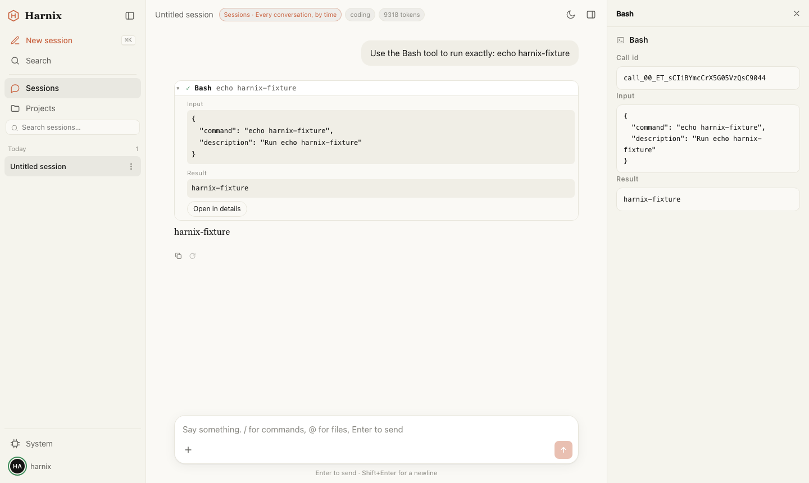

# Harnix

English | [简体中文](docs/README.zh-CN.md)

**The common base for [Agix](https://github.com/openatta/agix) applications.** An application on
Harnix is one Rust binary: the Agent engine, the web server, the application's own native extensions
and its interface, compiled together. Harnix supplies what such a product needs and cannot sensibly
build alone — sessions held by the server, engine instances, authorization, transport, the shell and
its spaces, a system view, an optional flow engine, and a host for extension packages that run
sandboxed in WebAssembly — and stays thin, so the product is the application's. Harnix itself is that
framework plus first-party extensions: the Harnix app (the sessions and projects spaces) and the
system space among them.



0.4.4. There is one concept, the **extension**, with three carriers: native (Rust in the binary),
WebAssembly in the product's process, WebAssembly in a process of its own. The extension interface
and the protocol only grow from 0.4.4 on; pin a tag (`Harnix-v<x.y.z>-<date><n>`) if you depend on one.

## Quick start

```sh
git clone --recurse-submodules https://github.com/openatta/Harnix.git
cd Harnix
pnpm install && pnpm --filter @harnix/shell build   # the interface; the binary embeds it
cargo build --release
./target/release/harnix                              # → http://127.0.0.1:4080/
```

Rust 1.88 or newer, Node with pnpm. `--recurse-submodules` matters: Agix lives at `agix/`. What runs
is the Harnix app and the system space: sessions, projects, and the system with the flows in it, and the
host for extension packages (mode 2, in-process).

No environment variable is required. With no model configured it still starts and says so:
**Set up a model** (or the avatar → **Settings → Models & credentials**) adds providers — Anthropic or
OpenAI-compatible APIs, one of them the default — kept in `~/.harnix/engine/settings.json`, never shown to the
browser or the logs. `ANTHROPIC_AUTH_TOKEN` (plus an optional `ANTHROPIC_BASE_URL`) works too.
The empty page of a new conversation walks through the first run in three cards — the model, a
project to work in, and what a conversation starts with: the `harnix` scene and the default
permission mode, with `code` (a coding agent in a project) offered beside it. Each goes once it is
done or closed.

Using the `harnix` program rather than building on it: the [user guide](user-guide/README.md) (also in [简体中文](user-guide/README.zh-CN.md)).

To look around with data in it: `scripts/harnix-demo.sh start` (also `stop`, `restart`, `status`)
runs the Harnix app in a directory of its own (`demo/` here, ignored by git) with demo flows, runs and
conversations, on the first free port from 4080 — nothing to set; delete the directory to start over.

## Architecture

```
            browser / desktop shell (Tauri)            other clients, other extensions
                        │  one protocol: frames, seq, topics, methods
 ┌──────────────────────▼──────────────────────────────────────────────────┐
 │ transport   one channel semantics over two topologies; static face; /ext/<id>/…
 │ router      one route table: every method, topic and route is a row — owner, handler,
 │             who may use it, which capability it needs, its scope
 │ authz       the one admission point: four kinds of subject (kernel, device, extension,
 │             engine) × row, default deny; the audit ring
 │ hub         sessions held by the server: subscription, buffered replay by seq,
 │             turn ownership, queue, steer, interrupt, headless taps, topics
 │ extensions  native: Rust linked in, capabilities granted where the product adds them —
 │             Harnix's own (system, harnix-app, settings, …) and the product's
 │             packages: installed .hxext, WebAssembly in this process (mode 2, the default)
 │             or one process per extension, sandboxed (mode 3); admitted by consent
 │ instances   Agix engines behind one link: in process, spawned daemons, attached, adopted;
 │             from templates, isolated, kept in a ledger across restarts
 └──────────────────────┬──────────────────────────────────────────────────┘
                        ▼
              harnix-engine, the one crate that uses Agix (agix/): turns, tools, scenes,
              permissions, packages
```

- **A turn belongs to the server, not to a tab.** The hub subscribes to every session before any
  client asks; a reload, another device or a dropped connection catches up by `seq`. Clients and the
  application's own extensions drive sessions through one set of semantics.
- **One concept: the extension.** A native `harnix::ext::Extension` declares what it contributes —
  methods, topics, spaces, routes, tools, interface, instance templates — and gets a context, not
  the hub's internals; its privileges are capabilities the product grants where it adds it. One that
  fails to migrate or start is disabled alone, with the reason on the diagnostics page.
- **Packages run sandboxed.** An extension package is a signed `.hxext` — a WebAssembly backend and
  tools, an Agix plugin for the agent side, an interface in isolated frames — that asks for each
  capability in its manifest and gets what a person consents to. In mode 2 (the default) it runs in
  the product's process; in mode 3 each one gets a process of its own with its own Agix, inside an
  operating-system sandbox, and Harnix only routes. Either way it is registered as the same kind of
  extension, on the same route table.
- **The interface is three columns per space**: a space's own left column, a centre that is the
  conversation unless it says otherwise (with an optional second side panel beside it), and a right
  column that is the open conversation's own dock — tabs any package registers (files, changes,
  output, a flow's progress) beside the space's own. Harnix's spaces — the Harnix app's two and the system space — are examples a
  product keeps or drops.
- **Cards in the conversation**: an extension writes entries into a session's log — they
  survive a refresh, a replay and a fork, and the model never sees them.
- **Flows** (`harnix-ext-flow`, optional): a graph of stations that moves one subject through work done
  by the run's main Agent, its sub-agents, the application's code or someone outside; each tool call
  judged against the flow's permissions, each station judged by its exit conditions and gates, hooks
  telling other systems about the progress. Run in a project, a flow is a task: started from the project,
  by `/flow` in one of its conversations or on a schedule, working in the project or a worktree of it.
- **Schedules** (`harnix-ext-schedule`, optional): at set times, a turn in a conversation, a new
  conversation, or a task — run by Harnix, in the schedule's own time zone.

Why it has this shape, layer by layer: [docs/concept_and_architecture.md](docs/concept_and_architecture.md).

```
crates/harnix          the crate an application depends on: ext, engine, first_party, App
crates/assembly        App::builder(): profile, start order, the extension host, diagnostics
crates/contract        the wire vocabulary and the extension interface's base types (S1)
crates/kernel          the skeleton's internal interfaces
crates/router          the one route table
crates/authz           admission and audit
crates/transport       channel semantics, topologies, handshake, static face, /ext/<id>/…
crates/hub             the session hub
crates/instance        the instance registry: Agix instances behind one link
crates/engine-api      the engine vocabulary an extension uses, without Agix (S1): Tool, SceneLayer, PromptGate, …
crates/engine-link     the engine as the skeleton reaches it (S3): the link, what it is asked, what it says
crates/engine          the one crate that uses Agix
crates/supervise       child processes: fork + exec, sandbox, reaping
crates/ext/api         harnix-ext, the extension interface (S1)
crates/host-api        the host-component interface (S3): carriers, spawning, adopting
crates/ext/<id>        Harnix's own extensions: system, harnix-app, settings, plugins,
                       observability, devices, flow and schedule (optional), packages
crates/carrier/*       the two package carriers: wasm (mode 2), proc (mode 3), and what they share
crates/package, wasm-port, wasm-host, wasm, proc
                       extension packages: manifest, signatures and store, the port, the host
                       core, wasmtime (the one place it is linked), the extension process
crates/client          the light client an application's own tools link
crates/cli             the `harnix` binary: every first-party extension, with flows and schedules
crates/testapp         an application for the tests
ui/packages/           @harnix/core (protocol, client, session state), @harnix/react (host API,
                       contribution registry, i18n, tokens), @harnix/shell (the shell core),
                       one UI package per first-party extension (@harnix/system, harnix-app, …),
                       @harnix/testkit, @harnix/ext-sdk and @harnix/ext-kit (a package's page in
                       its frame)
templates/             app (a new application), desktop (the Tauri shell)
examples/hello-app     an application built the way applications are
examples/packages/showcase  an extension package with one of everything
tests/live/            the LIVE suites: Playwright Test against the real binary
agix/                  Agix (submodule)
```

## Building on Harnix

Copy `templates/app`, add `harnix/` as its one submodule (`git submodule update --init --recursive` brings
what Harnix is built on), and follow the [extension guide](docs/harnix-ext.md): a guide, then every interface it uses. An application names only Harnix — the crate `harnix`, the
`@harnix/*` packages — and takes its problems and requests to Harnix's issues.
`examples/hello-app` is a complete application: two spaces, its own instance, a long job with a result
card, its own HTTP route and WebSocket, an approval card and a brand.

```rust
fn main() -> anyhow::Result<()> {
    harnix::App::builder()
        .name("hello-app", env!("CARGO_PKG_VERSION"))
        .extensions(harnix::first_party::standard())   // Harnix's own extensions
        .extension(Greeter::default()).ungranted()     // yours
        .run()
}
```

There are three modes, and no separate editions of the product:

| Mode | What it is |
|---|---|
| 1 | a pure Rust application: your native extensions and the first-party ones, nothing installed |
| 2 | Rust plus extension packages in the product's own process (WebAssembly). **The default** — native extensions plus mode 2 is what `harnix` itself ships and what a product is advised to ship |
| 3 | Rust plus one sandboxed process per extension package, for high-security scenes. Not the default: it is chosen with `carrier = "process"` in `[ext.packages]` |

What you write, and where it goes:

| You want | You write | See |
|---|---|---|
| Backend behaviour | a native extension (`harnix::ext::Extension`): methods, topics, routes, native tools, scenes, templates | [extensions](docs/harnix-ext.md) |
| An interface of your own | a space and contributions (`spaces/*/ui`, built into the shell) | [contribution points](docs/contribution_points.md) |
| Your look | `[brand]`, theme tokens, language packs | [extensions](docs/harnix-ext.md) |
| Agents that follow a process | flows: stations, skills, rules, policies, gates, hooks | the guide in the system space's flows, `crates/ext/flow/docs/guide.*.md` |
| A desktop app | `templates/desktop` (Tauri 2, local or remote) | `templates/desktop/README.md` |
| Let others add to your product | an extension package: a signed `.hxext` with a WebAssembly backend, an Agix plugin, an isolated interface — in your process (mode 2) or in one of its own (mode 3) | [extension packages](docs/harnix-ext-package.md) |
| Tests against the real binary | `@harnix/testkit`: replayed model calls, API and browser suites | [testing](docs/testing.md) |

A profile says what the process is; flags override it:

```toml
[brand]
name = "Hello"
icon = "brand.svg"
product_id = "hello-app"            # state in ~/.hello-app

[extensions]
off = ["system"]                    # linked-in extensions to switch off, with their rows

[ext.greeter]                       # each extension's own section
```

| Option | Meaning |
|---|---|
| `--profile` | the profile above; every section has an owner and refuses keys it does not know |
| `--port` / `--host` | `4080` / `127.0.0.1`; a non-loopback bind needs TLS and paired devices |
| `--engine-dir` | the engine's directory: `engine/` in the program's state, by default |
| `--data-dir` | where projects are: `$HARNIX_DATA_DIR`, then `~/Documents` |
| `--ui-dir` / `--headless` | serve the interface from a directory / serve none |
| `--launch-link` | keep the token out of the page: browsers come in through one-time links |

The program's own state is in `~/.<product_id>/` (`~/.harnix` by default, `HARNIX_STATE_DIR` moves
it), the engine's directory in it (`engine/`); projects in `~/Documents/`, with nothing hidden in it;
a project's own settings and data in its `.harnix/`.

## Documentation

| Document | For |
|---|---|
| [docs/concept_and_architecture.md](docs/concept_and_architecture.md) | What Harnix is — framework, Harnix app, system space — its parts, and why each boundary is where it is |
| [docs/app-development.md](docs/app-development.md) | The overview: the three modes (1 pure Rust; 2 Rust plus in-process extensions, the default; 3 Rust plus a process per extension, for high-security scenes), their resources, security and markets, how to choose, how the code is layered |
| [docs/harnix-ext.md](docs/harnix-ext.md) | Native extensions, building an application in Rust: the guide, then every type, method, profile key, flag, directory and topic |
| [docs/harnix-ext-package.md](docs/harnix-ext-package.md) | Writing an extension package (modes 2 and 3): package, manifest, WIT, interface, trust, store, tools, the two carriers; then its interfaces |
| [docs/harnix-app.md](docs/harnix-app.md) | The Harnix app: the sessions and projects spaces, their profile knobs, how they are built |
| [docs/system-space.md](docs/system-space.md) | The system space: agents, flows, extensions, diagnostics, the inspector, and where each reads from |
| [docs/contribution_points.md](docs/contribution_points.md) | The interface's contribution points, generated from the code |
| [docs/testing.md](docs/testing.md) | The LIVE test framework: the check layers, the runner and topologies, recordings, the coverage table, testkit for applications |
| [docs/glossary.md](docs/glossary.md) | The words, used one way |

*The documents are written in Chinese.* Requests from applications built on Harnix are
[GitHub issues](https://github.com/openatta/Harnix/issues), one label per project
([docs/issues](docs/issues/README.md) maps the numbers used in code to them).

## Tests

```sh
scripts/check.sh                # every layer this machine can run, cheapest first
scripts/check.sh --fast         # skip the model and the browser
scripts/check.sh --only api     # one layer
scripts/prune.sh                # build caches: a full run needs about 15 GB free
```

The LIVE suites run the real binary as a black box: `api` drives the backend through its own
protocol, `ui` drives the interface in chromium as a person would; model calls replay from
recordings unless `--live`. **Do not run `cargo test --workspace`**: it would also run the absorbed
Agix crates. Run Agix's tests in Agix.

## License

[Apache-2.0](LICENSE).
