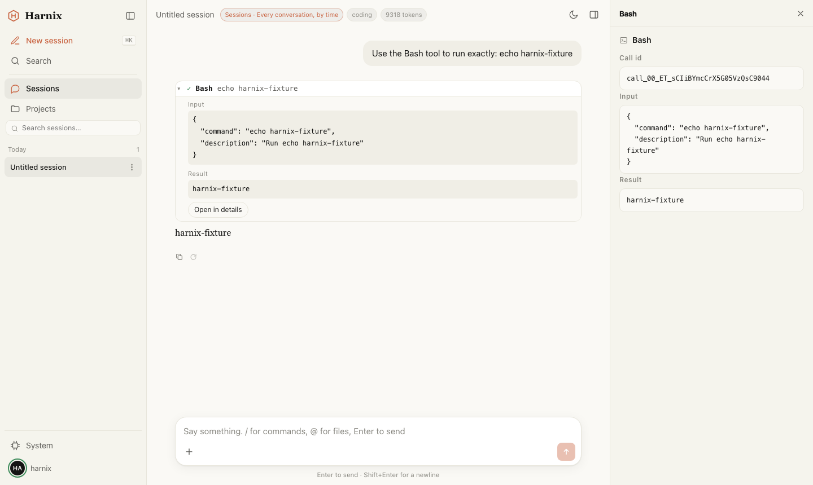

# Harnix

[English](../README.md) | 简体中文

**[Agix](https://github.com/openatta/agix) 应用的公共底座。** 在 Harnix 上做的应用是一个 Rust 二进制：Agent 引擎、
Web 服务、应用自己的模块和界面编译在一起。这类产品需要、又不值得各自去造的东西由 Harnix 提供——由服务端持有的会话、
引擎实例、授权、传输、外壳与 space、系统视图、可选的流程引擎——它自己保持薄，产品是应用自己的。



0.4。0.4.z 之内模块 API 与协议只增不改；依赖某个版本就钉住它的标签（`Harnix-v<x.y.z>-<日期><n>`）。

## 快速开始

```sh
git clone --recurse-submodules https://github.com/openatta/Harnix.git
cd Harnix
pnpm install && pnpm --filter @harnix/shell build   # 界面；二进制把它嵌进去
cargo build --release
./target/release/harnix                              # → http://127.0.0.1:4080/
```

需要 Rust 1.87 以上、Node 和 pnpm。`--recurse-submodules` 不能少：Agix 在 `agix/`。跑起来的是空应用：Harnix 自带的
space——会话、项目、流程、系统。

不需要任何环境变量。没配模型也能启动，页面会提示：**配置模型**（或头像 → **设置 → 模型与凭据**）添加 provider——
Anthropic 或兼容 OpenAI 的 API，其中一个是缺省——存在 `~/.agix/settings.json`，不会出现在浏览器或日志里。
`ANTHROPIC_AUTH_TOKEN`（可加 `ANTHROPIC_BASE_URL`）也行。

想看带数据的样子：`scripts/harnix-demo.sh start`（还有 `stop`、`restart`、`status`）在单独的目录（`~/harnix-demo`）里
跑空应用，带示例流程、运行和会话；删掉这个目录就从头来。

## 架构

```
              浏览器 / 桌面壳（Tauri）                  别的客户端、别的模块
                        │  一套协议：帧、seq、主题、方法
 ┌──────────────────────▼──────────────────────────────────────────────────┐
 │ transport   一套通道语义跑在两种拓扑上；静态面；/apps/<id>/
 │ authz       唯一的准入点：主体 × 方法 / 路由 / 主题，缺省拒绝
 │ hub         服务端持有会话：订阅、按 seq 补发缓冲、轮次归属、排队、引导、打断、
 │             无头会话的 tap、主题
 │ modules     编译进来：方法 app.<id>.*、主题、路由、原生工具与 scene、实例模板、space——
 │             Harnix 自带的功能也照同一份契约写
 │ instances   一条链路后面的多个 Agix 引擎：进程内、spawn 的 daemon、attach 的；
 │             由模板建、彼此隔离、记在台账里跨重启
 └──────────────────────┬──────────────────────────────────────────────────┘
                        ▼
                  Agix（agix/）：引擎——轮次、工具、scene、权限、包
```

- **一轮对话属于服务端，不属于某个标签页。** hub 在任何客户端开口之前就订阅了每个会话；刷新、换设备、断线都按 `seq`
  补上。客户端和应用自己的模块用同一套语义驱动会话。
- **模块是编译进来的，不是插进来的。** 一个 `harnix::Module` 声明它贡献什么，拿到的是一个上下文，不是 hub 的内部。
  迁移或启动失败的模块只停掉它自己，原因写在诊断页上。插件属于 Agix；Harnix 不执行包里的任何东西。
- **界面按 space 分三栏**：space 自己的左栏、中区（缺省是对话，旁边可以开二级栏）、space 自己的右栏页签。
  Harnix 自带的 space 都是例子，产品自己决定留哪些。
- **对话里的卡片**：模块往会话日志里写扩展条目——刷新、回放、分叉都在，模型看不见。
- **流程**（`harnix-flow`，可选）：一张站的图，带着一个对象走过由运行的主 Agent、子 Agent、应用代码或外部完成的工作；
  每次工具调用按流程的权限判，每一站按出站条件和门禁判，钩子把进度告诉别的系统。

为什么是这个形状，一层一层讲：[概念与架构](concept_and_architecture.md)。

```
crates/harnix     应用依赖的那个 crate
crates/app        App::builder()：profile、启动顺序、模块生命周期、诊断
crates/module     编译期模块契约：Module、它的注册表、ModuleContext
crates/hub        会话中枢
crates/instance   一条链路后面的 Agix 实例
crates/transport  通道语义、拓扑、握手、静态面、批量、/apps/<id>/
crates/authz      准入与审计
crates/builtin    Harnix 自己的功能，按公开契约写成模块
crates/contract   各层之间传递的类型
crates/flow       可选的流程模块 harnix-flow
crates/cli        `harnix` 二进制：空应用，带流程模块
crates/testapp    给测试用的应用
ui/packages/      @harnix/core（协议、客户端、会话状态）、@harnix/react（对话、贡献注册表、i18n、tokens）、
                  @harnix/shell、@harnix/flow、@harnix/testkit
templates/        app（新应用）、desktop（Tauri 壳）
examples/hello-app  照应用的方式做的一个应用
tests/live/       LIVE 测试：Playwright Test 对着真二进制
agix/             Agix（子模块）
```

## 在 Harnix 上二开

复制 `templates/app`，把 `harnix/` 加成唯一的子模块（`git submodule update --init --recursive` 带上 Harnix 依赖的一切），
照 [二开指南](harnix-sdk.md) 做；每个接口都列在 [SDK 参考](harnix-sdk-reference.md) 里。应用只认 Harnix——crate `harnix`、
`@harnix/*` 的包——问题与需求都提 Harnix 的 issue。`examples/hello-app` 是一个完整的应用：两个 space、自己的实例、一个带结果卡片的
长任务、自己的 HTTP 路由和 WebSocket、一张审批卡片、自己的品牌。

```rust
fn main() -> anyhow::Result<()> {
    harnix::App::builder()
        .name("hello-app", env!("CARGO_PKG_VERSION"))
        .with_builtins()
        .module(Greeter::default())       // 你的模块
        .module(harnix_flow::Flow::builder().build())   // 要流程就加上（完整的见 crates/cli/src/main.rs）
        .run()
}
```

要做什么、写什么、去哪看：

| 想要 | 写什么 | 看哪里 |
|---|---|---|
| 后端行为 | 一个 `harnix::Module`：方法、主题、路由、原生工具、scene、模板 | [二开指南](harnix-sdk.md) |
| 自己的界面 | 一个 space 和贡献（`spaces/*/ui`，构建进外壳） | [贡献点](contribution_points.md) |
| 自己的样子 | `[brand]`、主题 tokens、语言包 | [二开指南](harnix-sdk.md) |
| 让 Agent 按流程干活 | 流程：站、skill、规则、策略、门禁、钩子 | 流程 space 的参考页、`crates/flow/docs/guide.*.md` |
| 桌面应用 | `templates/desktop`（Tauri 2，本地或连远程） | `templates/desktop/README.md` |
| 对着真二进制的测试 | `@harnix/testkit`：回放模型调用，接口与浏览器测试 | [测试](testing.md) |

profile 说明这个进程是什么，命令行开关覆盖它：

```toml
[brand]
name = "Hello"
icon = "brand.svg"
product_id = "hello-app"            # 状态在 ~/.hello-app

[shell]
spaces = ["sessions", "projects"]   # 保留哪些自带的 space（不写就全保留）

[modules.greeter]                   # 每个模块自己的一节
```

| 开关 | 意思 |
|---|---|
| `--profile` | 上面那份 profile；每一节都拒绝它不认识的键 |
| `--port` / `--host` | `4080` / `127.0.0.1`；绑非回环地址要 TLS 和已配对的设备 |
| `--agix-dir` | 引擎的目录：`$AGIX_CONFIG_HOME`，再是 `~/.agix` |
| `--data-dir` | 项目在哪：`$HARNIX_DATA_DIR`，再是 `~/Documents` |
| `--ui-dir` / `--headless` | 从某个目录提供界面 / 不提供界面 |
| `--launch-link` | 令牌不进页面：浏览器从一次性链接进来 |

程序自己的状态在 `~/.<product_id>/`（缺省 `~/.harnix`，`HARNIX_STATE_DIR` 可以挪走）；引擎的在 `~/.agix/`；项目在
`~/Documents/`，里面不藏任何东西。

## 文档

| 文档 | 讲什么 |
|---|---|
| [概念与架构](concept_and_architecture.md) | Harnix 是什么、由哪些部分组成、每条边界为什么在那儿 |
| [二开指南](harnix-sdk.md) | 怎么在上面做应用 |
| [应用开发](app-development.md) | 三种做法：Rust 产品、嵌入的运行期应用、独立进程的运行期应用（只有设计） |
| [SDK 参考](harnix-sdk-reference.md) | 每个类型、方法、profile 键、开关、目录、主题 |
| [贡献点](contribution_points.md) | 界面的贡献点，由代码生成 |
| [测试](testing.md) | 测试分层、LIVE 测试、录像、覆盖表 |
| [术语](glossary.md) | 用词，一个词一个意思 |

在 Harnix 上做应用的项目提的需求记在 [GitHub issue](https://github.com/openatta/Harnix/issues) 里，每个项目一个标签
（代码里用的编号与 issue 的对照在 [docs/issues](issues/README.md)）。

## 测试

```sh
scripts/check.sh                # 这台机器能跑的每一层，便宜的先跑
scripts/check.sh --fast         # 跳过模型和浏览器
scripts/check.sh --only api     # 只跑一层
scripts/prune.sh                # 清构建缓存：跑一次全量要约 15 GB 空余
```

LIVE 测试把真二进制当黑盒：`api` 用它自己的协议驱动后端，`ui` 在 chromium 里像人一样操作界面；模型调用缺省从录像回放，
加 `--live` 用真模型。**不要跑 `cargo test --workspace`**：会连带跑吸收进来的 Agix crate。Agix 的测试在 Agix 里跑。

## 许可

[Apache-2.0](../LICENSE)。
