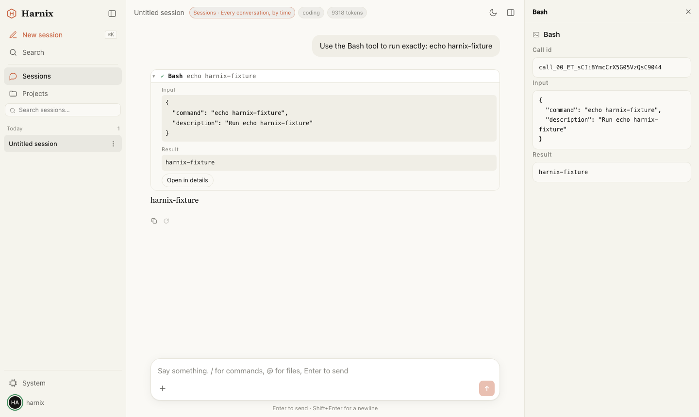

# Harnix

[English](../README.md) | 简体中文

**[Agix](https://github.com/openatta/agix) 应用的公共底座。** 在 Harnix 上做的应用是一个 Rust 二进制：Agent 引擎、
Web 服务、应用自己的原生扩展和界面编译在一起。这类产品需要、又不值得各自去造的东西由 Harnix 提供——由服务端持有的会话、
引擎实例、授权、传输、外壳与 space、系统视图、可选的流程引擎，以及跑在 WebAssembly 沙箱里的扩展包的宿主——它自己保持薄，
产品是应用自己的。Harnix 本身就是这个框架加上第一方扩展：Harnix app（会话 space 与项目 space）、系统 space 都在其中。



0.5。只有一个概念，**扩展**，有三种载体：原生（编进二进制的 Rust）、产品进程里的 WebAssembly、独立进程里的 WebAssembly。
0.5.z 之内扩展接口与协议只增不改；依赖某个版本就钉住它的标签（`Harnix-v<x.y.z>-<日期><n>`）。

## 快速开始

```sh
git clone --recurse-submodules https://github.com/openatta/Harnix.git
cd Harnix
pnpm install && pnpm --filter @harnix/shell build   # 界面；二进制把它嵌进去
cargo build --release
./target/release/harnix                              # → http://127.0.0.1:4080/
```

需要 Rust 1.87 以上、Node 和 pnpm。`--recurse-submodules` 不能少：Agix 在 `agix/`。跑起来的是 Harnix app 与系统 space：
会话、项目，以及带着流程的系统，还有扩展包的宿主（模式 2，进程内）。

不需要任何环境变量。没配模型也能启动，页面会提示：**配置模型**（或头像 → **设置 → 模型与凭据**）添加 provider——
Anthropic 或兼容 OpenAI 的 API，其中一个是缺省——存在 `~/.agix/settings.json`，不会出现在浏览器或日志里。
`ANTHROPIC_AUTH_TOKEN`（可加 `ANTHROPIC_BASE_URL`）也行。

想看带数据的样子：`scripts/harnix-demo.sh start`（还有 `stop`、`restart`、`status`）在单独的目录（`~/harnix-demo`）里
跑 Harnix app，带示例流程、运行和会话；删掉这个目录就从头来。

## 架构

```
              浏览器 / 桌面壳（Tauri）                  别的客户端、别的扩展
                        │  一套协议：帧、seq、主题、方法
 ┌──────────────────────▼──────────────────────────────────────────────────┐
 │ transport   一套通道语义跑在两种拓扑上；静态面；/ext/<id>/…
 │ router      一张路由表：每个方法、主题、路由都是表里的一行——所有者、处理者、
 │             谁能用、要什么能力、范围
 │ authz       唯一的准入点：四种主体（内核、设备、扩展、引擎）× 行，缺省拒绝；审计环
 │ hub         服务端持有会话：订阅、按 seq 补发缓冲、轮次归属、排队、引导、打断、
 │             无头会话的 tap、主题
 │ extensions  原生：编进来的 Rust，能力在产品加它的地方授予——Harnix 自己的
 │             （system、harnix-app、settings……）与产品的
 │             扩展包：装上的 .hxext，WebAssembly 在本进程里（模式 2，缺省）或每个
 │             扩展一个沙箱里的进程（模式 3）；按同意准入
 │ instances   一条链路后面的多个 Agix 引擎：进程内、spawn 的 daemon、attach 的、收养的；
 │             由模板建、彼此隔离、记在台账里跨重启
 └──────────────────────┬──────────────────────────────────────────────────┘
                        ▼
              harnix-engine，唯一用 Agix 的 crate（agix/）：轮次、工具、scene、权限、包
```

- **一轮对话属于服务端，不属于某个标签页。** hub 在任何客户端开口之前就订阅了每个会话；刷新、换设备、断线都按 `seq`
  补上。客户端和应用自己的扩展用同一套语义驱动会话。
- **一个概念：扩展。** 一个原生的 `harnix::ext::Extension` 声明它贡献什么——方法、主题、space、路由、工具、界面、实例模板——
  拿到的是一个上下文，不是 hub 的内部；它的特权是产品在加它的地方授予的能力。迁移或启动失败的扩展只停掉它自己，原因写在诊断页上。
- **扩展包跑在沙箱里。** 一个扩展包是一个签了名的 `.hxext`——WebAssembly 的后端与工具、Agent 一侧的 Agix 插件、隔离 iframe 里的界面——
  它要的每一项能力都写在清单里，得到的是人同意的那些。模式 2（缺省）里它跑在产品进程里；模式 3 里每个包一个自己的进程，
  带着自己的 Agix，关在操作系统沙箱里，Harnix 只路由。两种都登记成同一种扩展、进同一张路由表。
- **界面按 space 分三栏**：space 自己的左栏、中区（缺省是对话，旁边可以开二级栏）、space 自己的右栏页签。
  Harnix 自带的 space——Harnix app 的两个与系统 space——都是例子，产品自己决定留哪些。
- **对话里的卡片**：扩展往会话日志里写条目——刷新、回放、分叉都在，模型看不见。
- **流程**（`harnix-ext-flow`，可选）：一张站的图，带着一个对象走过由运行的主 Agent、子 Agent、应用代码或外部完成的工作；
  每次工具调用按流程的权限判，每一站按出口条件和门禁判，钩子把进度告诉别的系统。

为什么是这个形状，一层一层讲：[概念与架构](concept_and_architecture.md)。

```
crates/harnix          应用依赖的那个 crate：ext、engine、first_party、App
crates/assembly        App::builder()：profile、启动顺序、扩展宿主、诊断
crates/contract        线上词汇与扩展接口的基本类型（S1）
crates/kernel          骨架内部的接口
crates/router          那一张路由表
crates/authz           准入与审计
crates/transport       通道语义、拓扑、握手、静态面、/ext/<id>/…
crates/hub             会话中枢
crates/instance        实例登记表：一条链路后面的 Agix 实例
crates/engine-api      不带 Agix 的引擎词汇：Tool、SceneLayer、PromptGate……
crates/engine          唯一用 Agix 的 crate
crates/supervise       子进程：fork + exec、沙箱、收割
crates/ext/api         harnix-ext，扩展接口（S1）
crates/host-api        宿主组件的接口（S3）：载体、拉起进程、收养
crates/ext/<id>        Harnix 自己的扩展：system、harnix-app、settings、plugins、
                       observability、devices、flow（可选）、packages
crates/carrier/*       扩展包的两个载体：wasm（模式 2）、proc（模式 3），以及它们共用的部分
crates/package、wasm-port、wasm-host、wasm、proc
                       扩展包：清单、签名与商店、端口、宿主核心、wasmtime（唯一链它的地方）、扩展进程
crates/client          应用自己的工具链接的轻量客户端
crates/cli             `harnix` 二进制：全部第一方扩展，带流程扩展
crates/testapp         给测试用的应用
ui/packages/           @harnix/core（协议、客户端、会话状态）、@harnix/react（宿主 API、贡献注册表、i18n、tokens）、
                       @harnix/shell（外壳核心）、每个第一方扩展一个 UI 包（@harnix/system、harnix-app……）、
                       @harnix/testkit，@harnix/ext-sdk 与 @harnix/ext-kit（扩展包在 iframe 里的页面用）
templates/             app（新应用）、desktop（Tauri 壳）
examples/hello-app     照应用的方式做的一个应用
examples/packages/showcase  每样东西都有一个的扩展包
tests/live/            LIVE 测试：Playwright Test 对着真二进制
agix/                  Agix（子模块）
```

## 在 Harnix 上二开

复制 `templates/app`，把 `harnix/` 加成唯一的子模块（`git submodule update --init --recursive` 带上 Harnix 依赖的一切），
照 [原生扩展](harnix-ext.md) 做：前半是指南，后半是它用到的每个接口。应用只认 Harnix——crate `harnix`、
`@harnix/*` 的包——问题与需求都提 Harnix 的 issue。`examples/hello-app` 是一个完整的应用：两个 space、自己的实例、一个带结果卡片的
长任务、自己的 HTTP 路由和 WebSocket、一张审批卡片、自己的品牌。

```rust
fn main() -> anyhow::Result<()> {
    harnix::App::builder()
        .name("hello-app", env!("CARGO_PKG_VERSION"))
        .extensions(harnix::first_party::standard())   // Harnix 自己的扩展
        .extension(Greeter::default()).ungranted()     // 你的
        .run()
}
```

三种模式，没有分开的产品版本：

| 模式 | 是什么 |
|---|---|
| 模式 1 | 纯 Rust 应用：你的原生扩展加第一方扩展，不装任何东西 |
| 模式 2 | Rust + 进程内的扩展（扩展包，WebAssembly 跑在产品自己的进程里）。**缺省**——原生扩展加模式 2 就是 `harnix` 自己发布的形状，也是建议产品采用的形状 |
| 模式 3 | Rust + 每个扩展一个进程（每个扩展包一个沙箱里的进程），给高安全的场景。不是缺省：在 `[ext.packages]` 里写 `carrier = "process"` 选它 |

要做什么、写什么、去哪看：

| 想要 | 写什么 | 看哪里 |
|---|---|---|
| 后端行为 | 一个原生扩展（`harnix::ext::Extension`）：方法、主题、路由、原生工具、scene、模板 | [原生扩展](harnix-ext.md) |
| 自己的界面 | 一个 space 和贡献（`spaces/*/ui`，构建进外壳） | [贡献点](contribution_points.md) |
| 自己的样子 | `[brand]`、主题 tokens、语言包 | [原生扩展](harnix-ext.md) |
| 让 Agent 按流程干活 | 流程：站、skill、规则、策略、门禁、钩子 | 系统 space 里流程的参考页、`crates/ext/flow/docs/guide.*.md` |
| 桌面应用 | `templates/desktop`（Tauri 2，本地或连远程） | `templates/desktop/README.md` |
| 让别人往产品里装东西 | 扩展包：一个签了名的 `.hxext`，WebAssembly 后端、Agix 插件、隔离的界面——在你的进程里（模式 2）或各一个进程（模式 3） | [扩展包](harnix-ext-package.md) |
| 对着真二进制的测试 | `@harnix/testkit`：回放模型调用，接口与浏览器测试 | [测试](testing.md) |

profile 说明这个进程是什么，命令行开关覆盖它：

```toml
[brand]
name = "Hello"
icon = "brand.svg"
product_id = "hello-app"            # 状态在 ~/.hello-app

[extensions]
off = ["system"]                    # 链进来、但要关掉的扩展，连同它们的行

[ext.greeter]                       # 每个扩展自己的一节
```

| 开关 | 意思 |
|---|---|
| `--profile` | 上面那份 profile；每一节都有所有者，都拒绝它不认识的键 |
| `--port` / `--host` | `4080` / `127.0.0.1`；绑非回环地址要 TLS 和已配对的设备 |
| `--agix-dir` | 引擎的目录：`$AGIX_CONFIG_HOME`，再是 `~/.agix` |
| `--data-dir` | 项目在哪：`$HARNIX_DATA_DIR`，再是 `~/Documents` |
| `--ui-dir` / `--headless` | 从某个目录提供界面 / 不提供界面 |
| `--launch-link` | 令牌不进页面：浏览器从一次性链接进来 |

程序自己的状态在 `~/.<product_id>/`（缺省 `~/.harnix`，`HARNIX_STATE_DIR` 可以挪走）；引擎的在 `~/.agix/`；项目在
`~/Documents/`，里面不藏任何东西。

## 文档

| 文档 | 讲什么 |
|---|---|
| [概念与架构](concept_and_architecture.md) | Harnix 是什么——框架、Harnix app、系统 space——由哪些部分组成、每条边界为什么在那儿 |
| [应用开发](app-development.md) | 总览：三种模式（模式 1 纯 Rust；模式 2 Rust + 进程内的扩展，缺省；模式 3 Rust + 每个扩展一个进程，给高安全场景），它们的资源、安全、目标市场，怎么选，代码怎么分层 |
| [原生扩展](harnix-ext.md) | 用 Rust 在上面做应用：指南，以及每个类型、方法、profile 键、开关、目录、主题 |
| [扩展包](harnix-ext-package.md) | 写一个扩展包（模式 2 / 3）：包、清单、WIT、界面、信任、商店、工具、两种载体，以及它的接口 |
| [Harnix app](harnix-app.md) | Harnix app：会话 space 与项目 space，它们的 profile 开关，怎么做出来的 |
| [系统 space](system-space.md) | 系统 space：Agent、流程、扩展、诊断、检查器，以及每一样从哪读 |
| [贡献点](contribution_points.md) | 界面的贡献点，由代码生成 |
| [测试](testing.md) | LIVE 测试框架：检查的分层、运行器与拓扑、录像、覆盖表、给应用用的 testkit |
| [术语](glossary.md) | 用词，一个词一个意思 |

在 Harnix 上做应用的项目提的需求记在 [GitHub issue](https://github.com/openatta/Harnix/issues) 里，每个项目一个标签
（代码里用的编号与 issue 的对照在 [docs/issues](issues/README.md)）。

## 测试

```sh
scripts/check.sh                # 这台机器能跑的每一层，便宜的先跑
scripts/check.sh --fast         # 跳过模型和浏览器
scripts/check.sh --only api     # 只跑一层
scripts/prune.sh                # 清构建缓存：跑一次全量要约 15 GB 空余
```

LIVE 测试把真二进制当黑盒：`api` 用它自己的协议驱动后端，`ui` 在 chromium 里像人一样操作界面；模型调用缺省从录像回放，
加 `--live` 用真模型。**不要跑 `cargo test --workspace`**：会连带跑吸收进来的 Agix crate。Agix 的测试在 Agix 里跑。

## 许可

[Apache-2.0](../LICENSE)。
